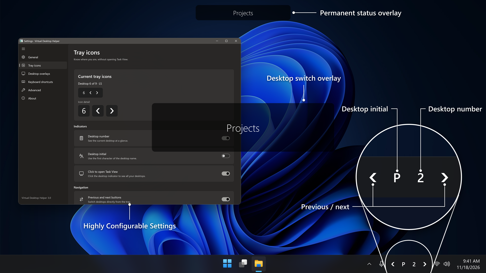
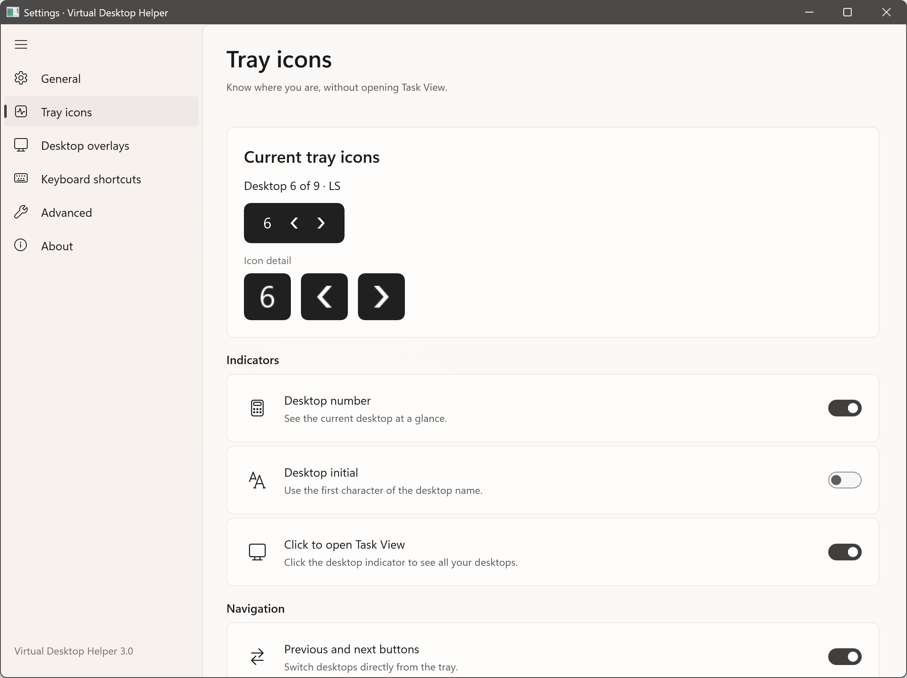
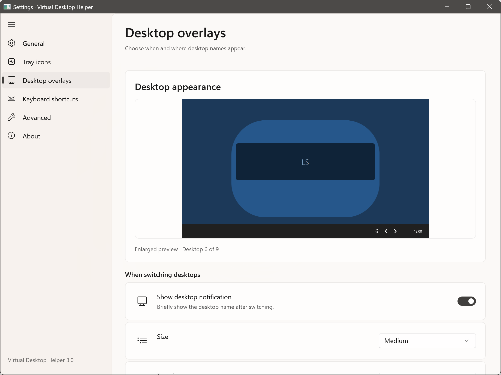

# Windows Virtual Desktop Helper

Simple and lightweight app to help with Virtual Desktops for Windows 11.

Built with Rust, with a lightweight native Windows tray app and a modern Settings interface.



<!-- release-links:start -->
[Get it from Microsoft Store](https://apps.microsoft.com/detail/9n4hnxprtsdc) |
[Download v3.0.1 Executable (.zip)](https://github.com/dankrusi/WindowsVirtualDesktopHelper/releases/download/v3.0.1/WindowsVirtualDesktopHelper.Executable.v3.0.1.zip) |
[GitHub Releases](https://github.com/dankrusi/WindowsVirtualDesktopHelper/releases)
<!-- release-links:end -->

Windows comes builtin with virtual desktops, however some important features are missing, such
as displaying which desktop you are on when switching. Windows Virtual Desktop Helper helps
fix some of these missing features.

Keywords: Virtual Desktop indicator, Virtual Desktop name, Virtual Desktop number

## ⚡ Features

* Show desktop number in notification area
* Show desktop name when switching desktops
* Show desktop name in a permanent status overlay
* Show prev/next desktop by clicking icons in notification area
* Show desktop initial in notification area
* Custom hot keys for virtual desktop actions
* Jump between the two most recently used desktops with a configurable hotkey
* Jump to desktop numbers using keyboard digits, numpad digits, or function keys
* Modern Settings with light/dark themes, shortcut recording, and live overlay previews
* Automatically recover after Windows Explorer restarts
* Autostart with Windows
* Simple and lightweight
* Configurable
* Free

<picture>
  <source media="(prefers-color-scheme: dark)" srcset="screenshots/WindowsVirtualDesktopHelper-Screenshot-02-tray-dark.png">
  <source media="(prefers-color-scheme: light)" srcset="screenshots/WindowsVirtualDesktopHelper-Screenshot-02-tray-light.png">
  
</picture>

<picture>
  <source media="(prefers-color-scheme: dark)" srcset="screenshots/WindowsVirtualDesktopHelper-Screenshot-03-overlays-dark.png">
  <source media="(prefers-color-scheme: light)" srcset="screenshots/WindowsVirtualDesktopHelper-Screenshot-03-overlays-light.png">
  
</picture>

[See all screenshots](screenshots/screenshots.md)


## 🚀 Installation

### Requirements

Windows Virtual Desktop Helper requires Windows 11.

On Windows 10, use [version 2.1](https://github.com/dankrusi/WindowsVirtualDesktopHelper/releases/tag/v2.1) or earlier. Version 3 and later do not run on Windows 10.

Settings requires Microsoft Windows App Runtime 2.4 or later. The Microsoft Store installs it automatically; for the portable executable, install the matching architecture of [Windows App Runtime](https://learn.microsoft.com/windows/apps/windows-app-sdk/downloads).

### Microsoft Store

You can install Windows Virtual Desktop Helper from the Microsoft Store.

[Get Windows Virtual Desktop Helper from Microsoft Store](https://apps.microsoft.com/detail/9n4hnxprtsdc)

<!-- release-setup:start -->
<!-- release-setup:end -->

### Executable

You can just run the executable file WindowsVirtualDesktopHelper.exe to use Windows Virtual Desktop Helper.

<!-- release-executable:start -->
[Download WindowsVirtualDesktopHelper Executable v3.0.1.zip](https://github.com/dankrusi/WindowsVirtualDesktopHelper/releases/download/v3.0.1/WindowsVirtualDesktopHelper.Executable.v3.0.1.zip) (x64)

Also available for [ARM64](https://github.com/dankrusi/WindowsVirtualDesktopHelper/releases/download/v3.0.1/WindowsVirtualDesktopHelper.Executable.v3.0.1.arm64.zip) and [x86](https://github.com/dankrusi/WindowsVirtualDesktopHelper/releases/download/v3.0.1/WindowsVirtualDesktopHelper.Executable.v3.0.1.x86.zip).
<!-- release-executable:end -->

### Scoop

A command-line installer for Windows

[https://scoop.sh/](https://scoop.sh/)

```scoop bucket add extras```

```scoop install windows-virtualdesktop-helper```


## 🎁 Donate

Do you like Windows Virtual Desktop Helper? 

[Donate via PayPal](https://www.paypal.com/donate/?hosted_button_id=BG5FYMAHFG9V6)


## 💻 Compatibility

Currently this app is compatible with Windows 11. For Windows 10, use [version 2.1](https://github.com/dankrusi/WindowsVirtualDesktopHelper/releases/tag/v2.1) or earlier.
Microsoft is constantly changing their API for the Virtual Desktops, so it appears not all builds of Windows are fully working yet.
Please note that if you use bleeding-edge Insider builds, this app may not yet be compatible.

The following versions are not supported:

* Windows 7
* Windows 8
* Windows Server
  
If you know of a working version or non-working version, please report it.


## 🗺️ Roadmap

While the goal of this app is to remain simple and lightweight, there are some features that will still be added:

* Console-Mode: allow a console-mode which can be used by scripts
* Make features more modular

 

## 📜 Changelog

See [CHANGELOG.md](CHANGELOG.md)


## 🤔 Frequently Asked Questions

### Help! This App doesn't work on my version of Windows 11

Microsoft is constantly changing the Windows APIs for managing virtual desktops - thus usually with each new version we have to write a new API wrapper to interface with Windows. This takes time, and sometimes is not easy to integrate with. Don't expect immediate support for un-released versions of Windows (like Insider).

### Where is the icon showing the screen number?

Windows automatically organizes the notification area icons, and places new ones in the icons menu under the ^ chevron. You can drag the screen number into the main icon area from there to have it always showing.

### Why are the prev/next screen icons in the wrong order?

Windows automatically organizes and orders the notification area icons. You can drag prev/next screen icons to organize them accordingly.

### Why is this app being reported by Windows Defender as untrusted?

Locally built executables and MSIX packages are unsigned by default. Windows may display an untrusted publisher warning for unsigned executables, and local MSIX installation requires a trusted signature. Packages distributed through the Microsoft Store are signed by the Store.

### Why is this app being reported by Windows Defender as malware?

Unsigned applications can trigger antivirus detections. Download the app from the [Microsoft Store](https://apps.microsoft.com/detail/9n4hnxprtsdc) or this project's GitHub Releases, and verify published SHA-256 checksums when available. If you believe a detection is a false positive, report it to your antivirus vendor.

### How do I open Settings?

Right-click a notification area icon and choose Settings. Closing Settings keeps the app running. If all desktop indicator features are disabled, a small app icon keeps the menu accessible.


## ⚙️ Configuration

The most common and basic settings can be configured using the GUI Settings. Controls save automatically, and overlay previews let you see appearance changes as you make them.

For more advanced configurations and features you can use the config file or command line arguments:

For example, one can set a hotkey to jump to a specific desktop by setting the following setting:

```
hotkeys.myCustomHotkey1 = "Ctrl + Alt + Shift + D1 = Desktop1"
hotkeys.myCustomHotkey2 = "Ctrl + Alt + Shift + D2 = Desktop2"
```

or use a custom shortcut for prev/next desktop:

```
hotkeys.myCustomKey1: "Alt + W = DesktopForward"
hotkeys.myCustomKey2: "Alt + Q = DesktopBackward"
```

See [Hotkeys Documentation](docs/Hotkeys.md) for more info.

### Settings

See [Settings Documentation](docs/Settings.md)
for a full list of all settings.

For the Store/MSIX installation, autostart is managed through Windows Startup Apps, accessible from Settings. Portable builds have an autostart toggle in Settings.

### Config File

The main file is ``%APPDATA%\WindowsVirtualDesktopHelper\WindowsVirtualDesktopHelper.exe.config``
(for example ``C:\Users\<USER>\AppData\Roaming\WindowsVirtualDesktopHelper\WindowsVirtualDesktopHelper.exe.config``), and can be edited with any text editor.

You can also open the configuration editor from Settings → Advanced. Use **Save** or **Ctrl+S** to validate and apply edits.

Additional ``.config`` files in the same directory load alphabetically before the main file.

Note: configuration lines that start with ``#`` are comments and ignored by the configuration system.

### Command Line Arguments

The app can be run with command line arguments to specify any configuration setting. For example, one could
run the app with the following command line arguments:

```
WindowsVirtualDesktopHelper.exe --theme.overlay.overlayBG.dark "red" --feature.showPrevNextIcons.nextChar "]" --feature.showPrevNextIcons.prevChar "["
```

Command line arguments take precedence over the config file settings and are not saved to the config file.


## 🔧 How it works

This program works by using some unofficial/undocumented Windows APIs which Windows uses internally to manage the desktop.
The unofficial nature of these APIs is very unfortunate, because it means that each time Windows 11 makes an update, we have
to reverse engineer the APIs and their undocumented COM CLSIDs - which is tedious and wastes a lot of time.

This is why the maintainers are reluctant to add too many other features, because it's enough of a task to keep
up with all the Windows updates for the basic features.

The app uses Rust and native Windows APIs for the tray icons, overlays, and hotkeys. Settings uses WinUI 3 and opens in a separate process only when needed. See [Architecture](docs/architecture.md) for more details.


## ⚒ Building & Contributing

Install Rust 1.95 or later with the MSVC toolchain, Visual Studio C++ Build Tools, and a Windows SDK.

```powershell
cargo build --release --locked
.\target\release\WindowsVirtualDesktopHelper.exe
```

Run the automated checks before submitting changes:

```powershell
.\scripts\check.ps1
```

For MSIX packages, portable ZIP archives, and Microsoft Store upload archives, see [MSIX packaging and signing](docs/msix.md). The included GitHub Actions workflow runs the checks and builds packages for x64, x86, and ARM64. To publish a release, see [Releasing](docs/releasing.md). Distributable artifacts are written to ``dist/``.

### Dependencies

The app uses ``windows-sys`` for Windows APIs, ``windows-reactor`` for WinUI 3 Settings, and ``uuid`` for stable identifiers. Release builds ship as a single native executable, with Settings using the Windows App Runtime listed above. Third-party notices are in [licenses/](licenses/).

### The Hunt for CLSIDs

See [Architecture](docs/architecture.md) for how the app selects the undocumented virtual desktop interfaces. New Windows builds may require updated API profiles.

### Your help is wanted!

Bug reports, contributions, and compatibility testing on different Windows builds are welcome. Follow the [manual compatibility checks](docs/validation.md) when changing Windows integration.


## 🙏 Thanks

Many thanks for the original API work done by [MScholtes](https://github.com/MScholtes) and contributions by [Flaflo](https://github.com/Flaflo).

Thanks to the following contributors:
 - [y2nd66](https://github.com/y2nd66)
 - [SleepyBag](https://github.com/SleepyBag)
 - [yossdev](https://github.com/yossdev)
 - [MadoScientist97](https://github.com/MadoScientist97)
 - [...and more](https://github.com/dankrusi/WindowsVirtualDesktopHelper/pulls?q=is%3Apr+is%3Aclosed)


	 
## 🤩 You might also like...

### Windows Taskbar Helpers

A free utility to make the Windows 11 Taskbar just a little bit more useful by allowing you to pin quick launchers that always open a new folder, app or anything.

[](https://github.com/dankrusi/WindowsTaskbarHelpers)

[github.com/dankrusi/WindowsTaskbarHelpers](https://github.com/dankrusi/WindowsTaskbarHelpers)

### LitePDF

A free and lightweight no-BS PDF viewer. And no, it doesn't have AI.

[](https://github.com/dankrusi/LitePDF)

[github.com/dankrusi/LitePDF](https://github.com/dankrusi/LitePDF)
