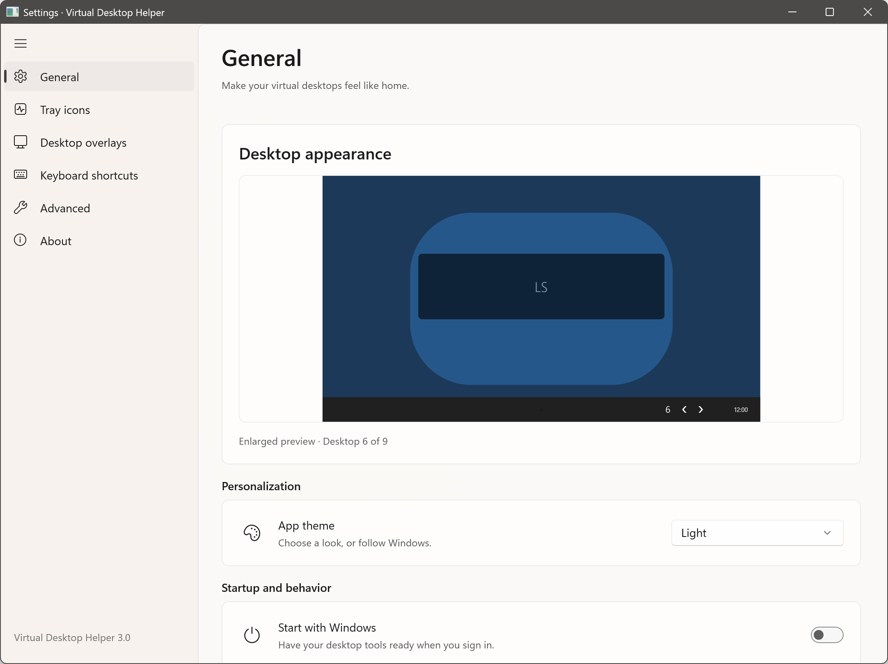
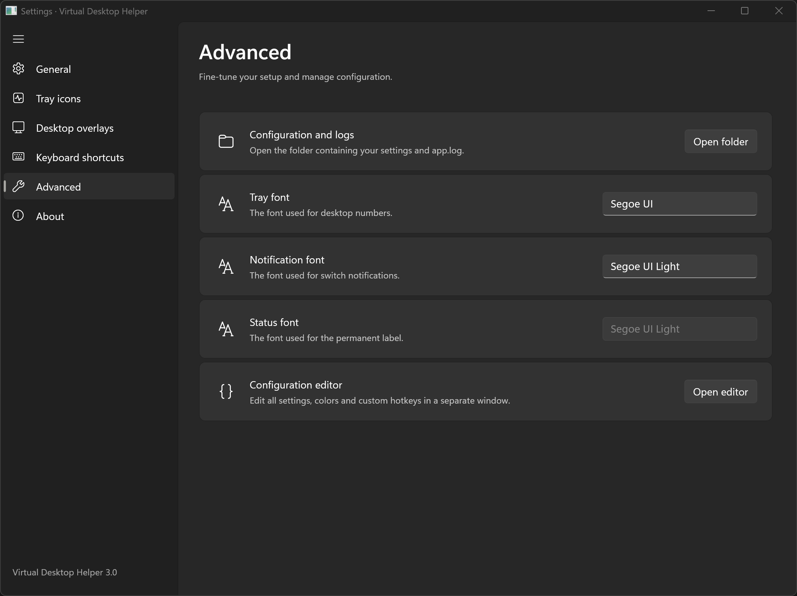
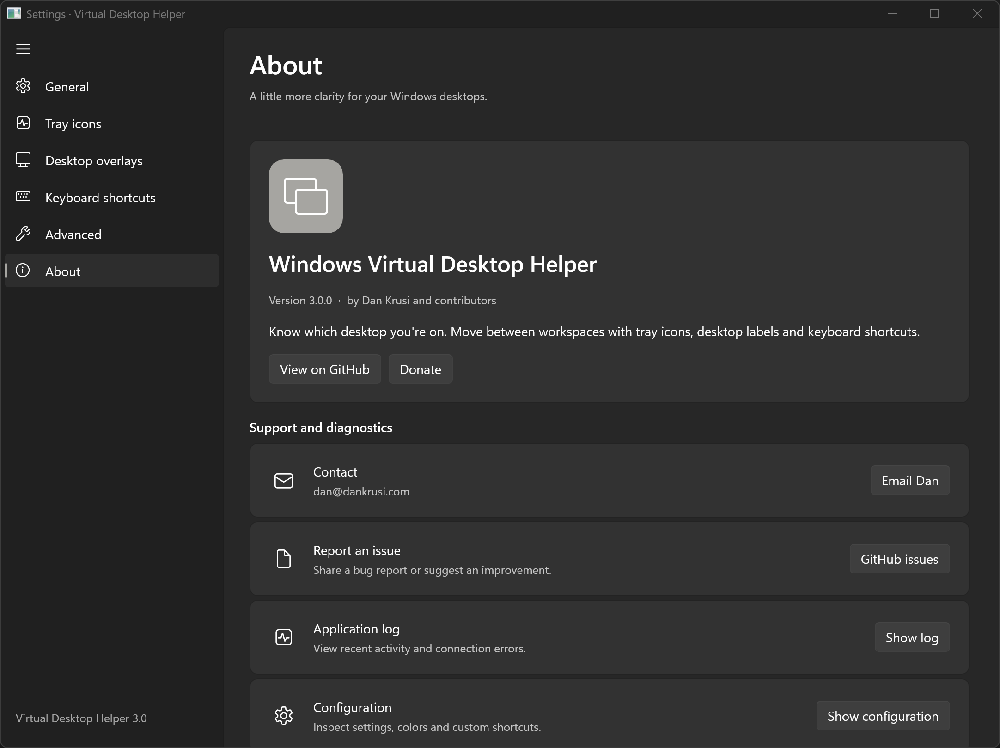

# Screenshots

Generated by `scripts/screenshot-settings.ps1` from the images in this folder. Run it with `--index-only` to refresh this page after adding or renaming images.

## Overview

| Light | Dark |
| --- | --- |
|  |  |

## Settings

### General

| Light | Dark |
| --- | --- |
|  |  |

### Tray icons

| Light | Dark |
| --- | --- |
|  |  |

### Desktop overlays

| Light | Dark |
| --- | --- |
|  |  |

### Keyboard shortcuts

| Light | Dark |
| --- | --- |
|  |  |

### Advanced

| Light | Dark |
| --- | --- |
|  |  |

### About

| Light | Dark |
| --- | --- |
|  |  |
